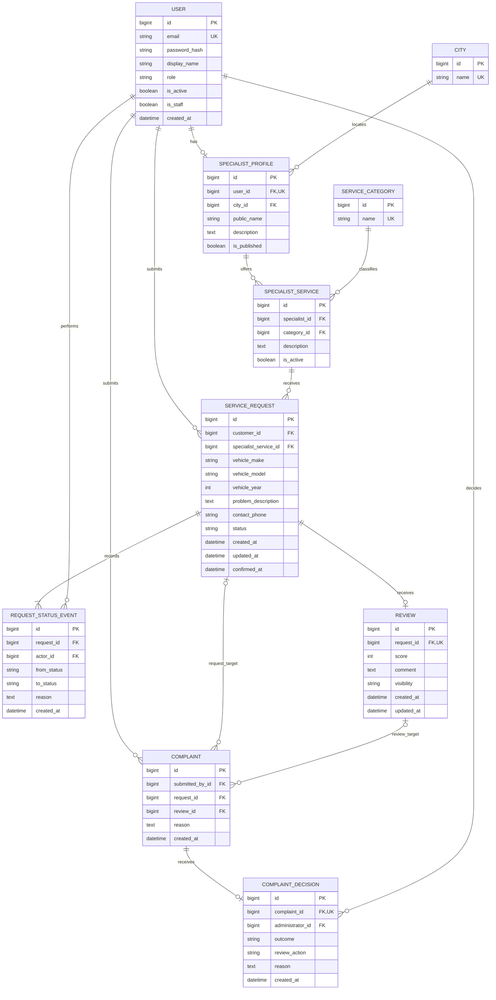

# Database Design and ER Diagram

Status: Initial design for PostgreSQL and Django; implementation and supervisor review pending.

## Entity relationships

The diagram is editable Mermaid source rendered by GitHub. PK means primary key, FK means foreign key, and UK means unique key. Optional target references are explained below.

## Design decisions

| Entity | Purpose and constraints |
|---|---|
| User | Custom Django user model planned before initial migrations. Roles: customer, specialist, administrator. Normalise emails and enforce case-insensitive uniqueness. Passwords use Django password hashing; password_hash is the conceptual field, mapped to Django's password field. Staff access and role permissions must agree. |
| City / Service category | Controlled search values. Initial dataset remains to be agreed. |
| Specialist profile | At most one profile per user. Backend requires specialist role. City is required; only published profiles appear publicly. |
| Specialist service | Join entity between a specialist and a category, with unique (specialist_id, category_id). A specialist can offer multiple categories. |
| Service request | One customer and one specialist service per request. Assigned specialist is derived through that service, avoiding a second inconsistent specialist reference. Required: make, model, problem and contact phone. Vehicle year is nullable. confirmed_at is nullable until completion. |
| Request status event | Append-only status history: actor, previous state, next state, reason and time. Creation produces an initial event with null from_status and New as to_status. At least one event per request is an application invariant. |
| Review | Non-null unique request_id enforces at most one review per request, including hidden reviews. Author is derived from request.customer_id; specialist is derived from the request's service. Score is an integer from 1 to 5, comment is required, visibility is published or hidden. |
| Complaint | Exactly one target: request_id OR review_id, never both or neither. Submitter and reason are required. Request-target complaints are allowed only from the customer or assigned specialist; signed-in users can report published reviews. |
| Complaint decision | At most one final decision per complaint in the initial scope. Outcome: resolved or dismissed. review_action: none or hide. Administrator, explanation and time are required. No decision means the complaint is Open; otherwise its status is derived from outcome. |

All fields are required unless explicitly described as nullable. Request event reasons may be blank except when the transition requires a reason. Review updated_at initially equals created_at; optional review editing remains outside the initial implementation scope.

The simplified diagram omits Django's internal permission, session and migration tables. Public registration must never assign administrator role or staff access.

## Request lifecycle

Allowed states are New, Accepted, Declined, Cancelled, In progress, Awaiting customer confirmation, Completion disputed and Completed. Exact actors and transitions are defined in [requirements.md](requirements.md#request-statuses).

- Persist each allowed transition and its history event in one transaction.
- Lock the request while checking and changing its state to avoid conflicting concurrent transitions.
- Set confirmed_at only when the customer confirms completion. Completed requires a non-null confirmed_at; other states require it to be null.
- Completed, Declined and Cancelled are terminal in the initial scope.
- Request ownership and service assignment cannot change after creation.
- A specialist service's specialist and category references cannot be reassigned after it has requests. Deactivate the old service and create a new one when needed.

## Verified reviews and ratings

Review submission must check the authenticated customer against the request owner and require Completed status and confirmed_at. Perform eligibility checks and insertion in one transaction while locking the request. Handle a unique-constraint conflict as a duplicate submission.

A database unique constraint protects against duplicates; it does not prove ownership or completion. Those cross-table rules need explicit backend enforcement. A customer may give a low score after confirming completion.

Do not store an independently editable average rating. Calculate it from published eligible reviews for all services belonging to the specialist:

- Rating = sum of published scores / number of published reviews.
- Display one decimal place and the published review count.
- With no published reviews, display “Not yet rated”.
- Sort by the unrounded average descending, then review count descending, with a stable profile-ID tie-breaker. Unrated profiles come last.

## Complaints and moderation

A database check constraint enforces exactly one complaint target. Backend permission checks enforce access to private request targets. Complaint creation does not change the service-request state.

An administrator records a final decision in a transaction. Hiding is permitted only for a review-target complaint resolved for a documented rule violation. A dismissed complaint cannot hide a review. Save the decision and change the review visibility together. A hidden review still occupies its unique request reference.

Multiple complaints can concern the same target. Their decisions remain separate; recording a second hide action for an already hidden review does not create a new review. Restoring reviews, reopening decisions and appeals are outside the initial workflow and require a later design decision.

## Integrity, privacy and retention

- Use foreign keys and protect referenced users, services, requests, reviews and complaints from cascading deletion.
- Deactivate accounts/services and unpublish profiles when appropriate; define any later anonymisation or retention policy separately.
- Customer and assigned specialist may access their own request records; authorised administrators may access records needed for moderation.
- Public review responses expose display name, score, comment and review date, not contact_phone, email or private request details.
- Preserve status and decision history. Restrict direct admin edits that could bypass the lifecycle or review rules.
- Index request(customer_id, created_at), request(specialist_service_id, status), profile(city_id, is_published), service(category_id, is_active), history(request_id, created_at) and complaint(submitted_by_id, created_at). Unique references also need unique indexes. Final indexes will be reviewed against real queries.

## Requirement mapping and next step

| Requirements | Supporting entities |
|---|---|
| FR-01 | User |
| FR-02–04 | City, Specialist profile, Service category, Specialist service, Review |
| FR-05–08 | Service request, Request status event |
| FR-09–10, FR-13 | Service request, Review, Complaint decision |
| FR-11–12 | Complaint, Complaint decision |
| NFR-02–05 | Backend permissions, constraints, transactions and protected history |

Next: define the API endpoints and permission rules, then implement Django models and migrations. This document describes a proposed schema; no database has been created or tested.

[Technology choices](technology-comparison.md) · [Other diagrams](diagrams/README.md)
