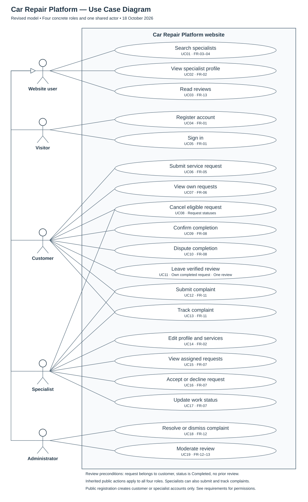

# Use Case Diagram

## Files

- [SVG source](use-case.svg): editable vector drawing and readable diagram export.
- [PlantUML source](use-case.puml): editable UML model with the same actors and use cases. Rendering this file may produce a different layout.

## Interpretation

The rectangle is the website boundary. Actors are outside the system; ellipses represent user goals. Solid lines indicate participation, not a sequence of steps. UC identifiers map to the functional requirements in [requirements.md](../requirements.md).

Visitors can browse and register or sign in. Signed-in users retain access to public browsing. Public registration creates customer or specialist accounts only; administrator access is assigned separately. Specialists may report reviews or problems with their assigned requests through the complaint workflow.

Only the request owner may leave one review after confirming service completion. Confirmation does not imply satisfaction: negative reviews remain possible. The administrator moderates rule violations, not low scores alone.

The diagram groups related actions for readability. Optional review editing (FR-14) is outside this initial diagram. See the requirements document for detailed permissions and request transitions.

Status: Initial design, 18 October 2026.
