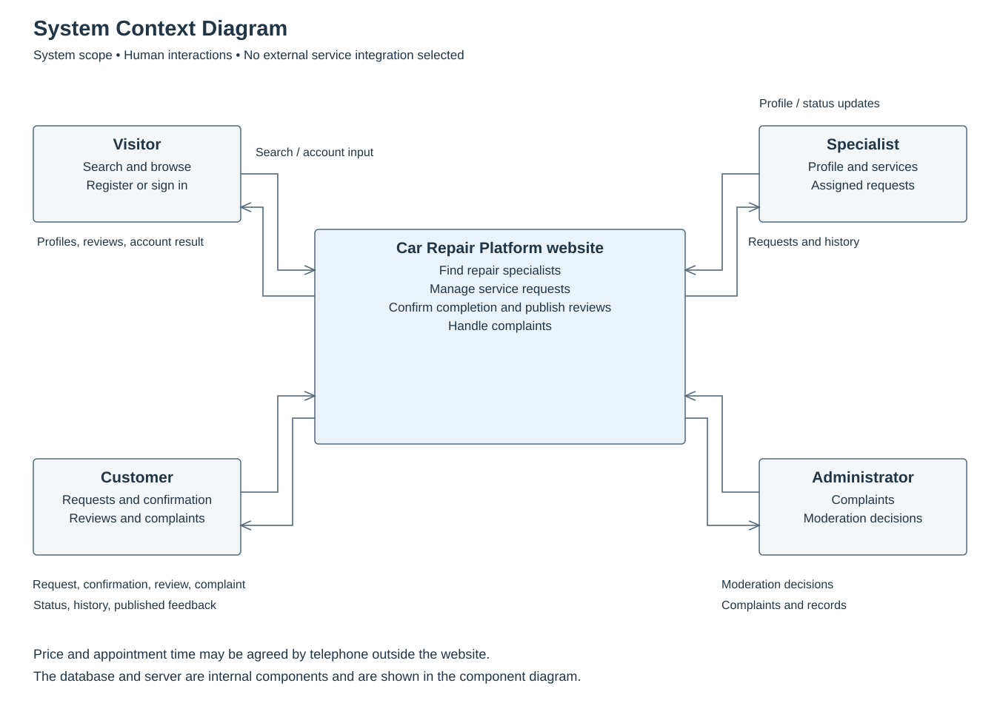
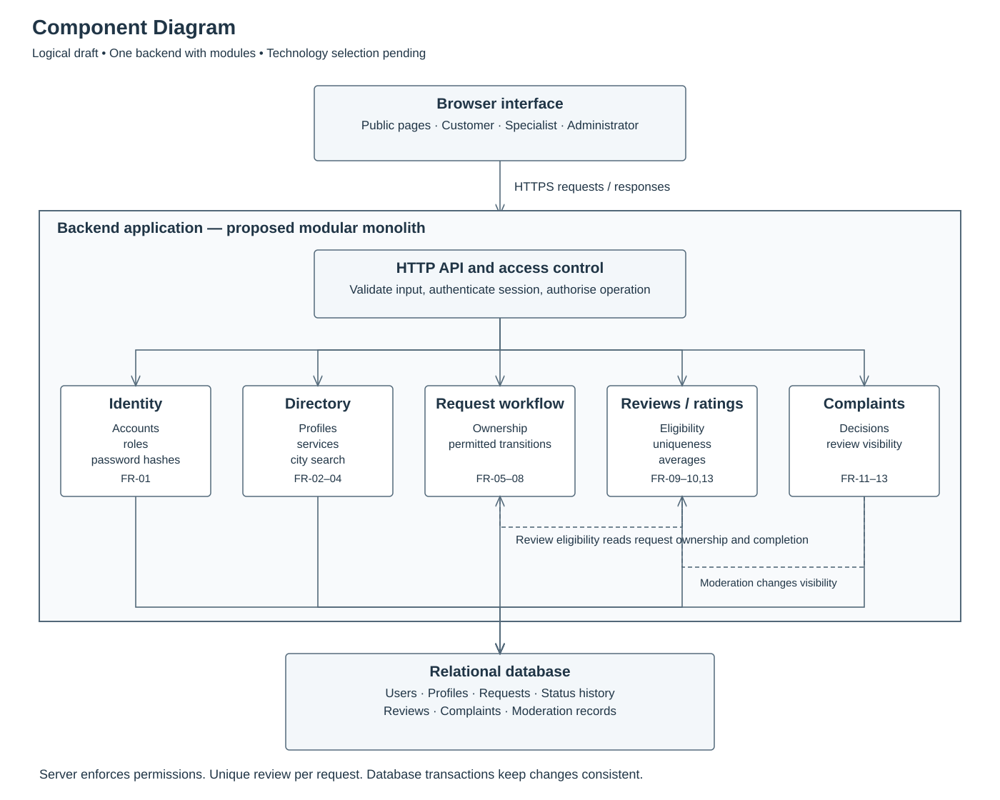

# Website diagrams

Initial design for the Car Repair Platform. These diagrams describe a proposal, not an implemented system or supervisor-approved architecture.

## Use case diagram

[Editable PlantUML model](use-case.puml) · [Editable SVG and readable export](use-case.svg)

Four concrete roles inherit common public browsing capabilities from the shared Website user actor. The hollow triangle points toward that general actor; it does not represent a process step. A visitor can register or sign in; public registration allows only customer or specialist roles. Administrators receive access separately.

Separate use cases now describe registration, sign-in, request submission, request viewing, confirmation, dispute and review. A specialist also participates in eligible cancellation and complaint submission/tracking. Review preconditions are shown beside the review use case: customer ownership, Completed status and no previous review. Completion does not imply satisfaction. A low score alone does not justify removing a review.

Solid actor associations show participation; they do not describe execution order. Authentication is a precondition for private actions, not a mandatory included sign-in step every time. No include/extend relations are added merely for decoration. Optional review editing and low-level validation are omitted from this overview.

The UC identifiers were revised with the new diagram; FR identifiers still refer to [requirements.md](../requirements.md).

## System context

[Editable PlantUML model](system-context.puml) · [Editable SVG and readable export](system-context.svg)

The website is one system interacting with visitors, customers, specialists and administrators. Arrows name information exchanged. The database is internal and therefore belongs in the component view. Telephone arrangements happen outside the website. No payment, chat, map or notification provider is assumed at this stage.

## Components

[Editable PlantUML model](components.puml) · [Editable SVG and readable export](components.svg)

This is a logical draft for a modular monolith: one backend application containing identity, directory, request, review and complaint modules. It is not a microservice deployment plan. A browser interface calls the HTTP API; server-side code checks authentication, permissions and input. Modules read and write a relational database.

The review module checks request ownership and confirmed completion. A unique database constraint on the request reference prevents duplicate reviews. Transactions must keep verification and writes consistent. Moderation changes review visibility and therefore affects rating calculation while retaining decision history. Passwords are stored as salted hashes. The selected stack is React, Django/DRF and PostgreSQL; see the [technology comparison](../technology-comparison.md). Hosting remains to be decided.

PlantUML files encode the logical models. SVG files are editable drawings with a manually arranged layout; rendering PlantUML may produce a different layout. PNG exports are included in the downloadable local design package, while SVG is the readable repository format.

## Database ER diagram

See the [database design and editable Mermaid ER diagram](../database-design.md) for entities, cardinalities, constraints and review-verification rules.

## Next review

Confirm the initial cities and service categories, handling of abandoned requests, and moderation rules with the supervisor. The [interactive prototype](../prototype/README.md) illustrates selected workflows but does not implement production security or persistence.
